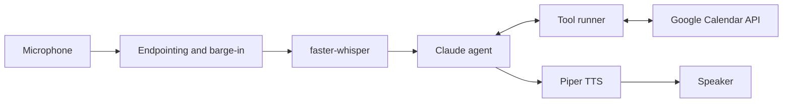

# Voice Receptionist

A voice agent that answers calls for a physiotherapy clinic. It listens to the caller, checks a real Google Calendar for availability, books the appointment and confirms it out loud. Callers can interrupt it mid-sentence, the same way they would with a person.

Speech recognition and speech synthesis run locally. Claude handles the conversation and decides when to call tools.

## Demo

Excerpt from a test call (phone number replaced):

```
Receptionist: Hello, you're through to Riverside Physio. How can I help you today?
Caller: Can I book something on Wednesday?
[tool] check_availability(date="2026-11-11") -> 10 free slots
Receptionist: Yes, we have Wednesday the eleventh free from nine in the morning until a quar...
(caller interrupted)
Caller: Sorry, actually make it Thursday.
[tool] check_availability(date="2026-11-12") -> 10 free slots
Receptionist: No problem, Thursday the twelfth has the same times free. Is there a time of day that suits you best?
...
Caller: 07700 900123.
Receptionist: Thanks. That's oh seven seven oh oh, nine oh oh, one two three. Is that right?
Caller: Yeah, that is right.
Receptionist: Before I book, let me confirm: Tejas Bornare, Thursday the 12th of November at noon. Shall I go ahead?
Caller: Yeah, please go ahead.
[tool] book_appointment(date="2026-11-12", time="12:00", ...) -> confirmed, reference A42ACE
Receptionist: Your appointment is booked for Thursday the 12th of November at noon. Your booking reference is A42ACE. Is there anything else I can help you with?
Caller: That's all, thank you.
[tool] end_call()
Receptionist: You're welcome. Goodbye!
```

The booking then appears in the clinic's Google Calendar with the caller's name, number and reference.

## How it works



Each turn of the conversation:

1. **Listen.** Audio is read in 30 ms blocks. The caller has finished speaking after 800 ms of quiet, measured against a noise threshold calibrated at the start of the call.
2. **Transcribe.** The clip goes to Whisper (`faster-whisper`, int8 on CPU) with a short hint describing the call, which improves accuracy on times and phone numbers.
3. **Think.** Claude gets the conversation history and three tools: `check_availability`, `book_appointment` and `end_call`. It may call several tools before replying.
4. **Act.** The tool runner validates every request and talks to Google Calendar.
5. **Speak.** The reply is synthesised with Piper and played while the microphone keeps listening, so the caller can cut in.

## Design decisions

**Business rules live in code, not the prompt.** The model never writes to the calendar directly. The tools reject weekends, past dates, malformed phone numbers and taken slots, and the slot is re-checked immediately before the event is created, so two callers can't book the same time.

**Tool errors go back to the model.** If a slot is taken or the calendar API fails, the tool returns an error with a hint instead of raising. The agent recovers in conversation, for example by offering another time.

**The calendar is behind an interface.** `InMemoryCalendar` and `GoogleCalendar` expose the same two methods, and `CALENDAR_BACKEND` picks one. Development and testing don't need Google at all.

**Barge-in is stricter than normal listening.** While the receptionist is talking, the caller has to be 3.5 times louder than the usual threshold for about 360 ms within a 450 ms window. That ignores coughs and echo but still catches real speech. If an interruption turns out to contain no words, she repeats what she was saying instead of losing her place.

**The microphone stays open for the whole call.** Opening it per turn made Bluetooth headsets switch audio mode, which cut off the first second of every reply.

**The system prompt is fixed for the call.** It originally included the current time and was rebuilt every turn. Claude's thinking blocks are bound to the system prompt they were produced with, so the conversation broke as soon as the minute changed. The prompt is now built once, when the call starts.

**Text is normalised before speech.** Long digit strings are rewritten as spoken digits in UK groupings ("oh seven eight six seven, oh five three…"). Without this, TTS read a phone number as "seven billion, eight hundred and sixty-seven million…".

**Every wait has a deadline.** If the audio device stops delivering samples, the call fails with a clear error instead of hanging.

**There's a text mode.** `python main.py --text` runs the same agent with typed input, which makes testing conversation logic much faster than speaking every turn.

## Project structure

```
receptionist/
  config.py           settings loaded from .env
  stt.py              microphone capture, endpointing, barge-in, Whisper
  tts.py              Piper synthesis, playback, text normalisation
  agent.py            system prompt, conversation history, tool-calling loop
  tools.py            tool schemas and validation
  calendar_client.py  in-memory and Google Calendar backends, OAuth
scripts/
  check_audio.py      record and play back 3 seconds
  check_calendar.py   connect to Google and list tomorrow's free slots
  try_stt.py          speech-to-text on its own
  try_tts.py          speech-to-text plus text-to-speech, no agent
main.py               entry point (voice or --text)
```

## Getting started

**You'll need:** Python 3.12 (some audio packages don't have wheels for 3.13+ yet), a microphone and speakers (a headset works best), an [Anthropic API key](https://console.anthropic.com), and a Google account for the calendar.

### 1. Install

```bash
git clone https://github.com/<your-username>/voice-receptionist.git
cd voice-receptionist
python -m venv .venv
.venv\Scripts\activate        # macOS/Linux: source .venv/bin/activate
pip install -r requirements.txt
```

### 2. Download a voice

```bash
mkdir -p models/voices
cd models/voices
python -m piper.download_voices en_GB-alba-medium
cd ../..
```

The Whisper model downloads automatically on first run.

### 3. Configure

Copy `.env.example` to `.env` and fill it in:

```
ANTHROPIC_API_KEY=sk-ant-...
BUSINESS_NAME=Riverside Physio
TIMEZONE=Europe/London
LLM_MODEL=claude-haiku-5-5
GOOGLE_CALENDAR_ID=...@group.calendar.google.com
CALENDAR_BACKEND=google
```

To try it without Google, set `CALENDAR_BACKEND=memory`. That uses a fake diary with a few slots already booked.

### 4. Connect Google Calendar

1. Create a calendar for the clinic in Google Calendar and copy its **Calendar ID** from *Settings and sharing → Integrate calendar*.
2. In [Google Cloud Console](https://console.cloud.google.com), create a project and enable the **Google Calendar API**.
3. Set up the **OAuth consent screen** (External) and add your Google account as a **test user**.
4. Create an OAuth client of type **Desktop app**, download the JSON and save it as `credentials.json` in the project root.
5. Run `python -m scripts.check_calendar`. A browser window asks you to approve access once, and the token is saved to `token.json`.

### 5. Run

```bash
python main.py --text    # type instead of speaking
python main.py           # full voice
```

## Configuration

| Variable | Default | Purpose |
|---|---|---|
| `ANTHROPIC_API_KEY` | | Claude API key |
| `LLM_MODEL` | `claude-haiku-5-5` | Model used for the conversation |
| `BUSINESS_NAME` | `Riverside Physio` | Name used in greetings |
| `TIMEZONE` | `Europe/London` | Clinic time zone |
| `CALENDAR_BACKEND` | `memory` | `memory` or `google` |
| `GOOGLE_CALENDAR_ID` | | Calendar that holds the bookings |
| `WHISPER_MODEL` | `base.en` | `small.en` is more accurate but slower |
| `TTS_VOICE` | `models/voices/en_GB-alba-medium.onnx` | Piper voice file |

## Known limitations

- **Names and accents.** `base.en` often gets unfamiliar names wrong. The agent confirms names as a question, which helps, and `small.en` is more accurate at the cost of latency.
- **Energy-based speech detection.** A noisy room can trigger recordings, and Whisper sometimes invents filler words ("yeah", "thank you") from noise. A model-based VAD such as Silero would be more reliable.
- **Barge-in is tuned for a headset.** On laptop speakers without echo cancellation, the receptionist's own voice can be mistaken for an interruption.
- **Replies are synthesised in full before playback,** which adds latency on long answers. Streaming sentence by